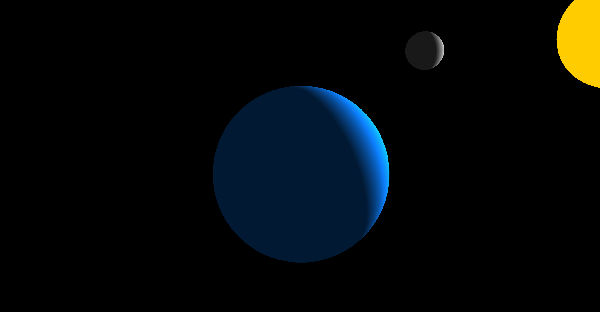
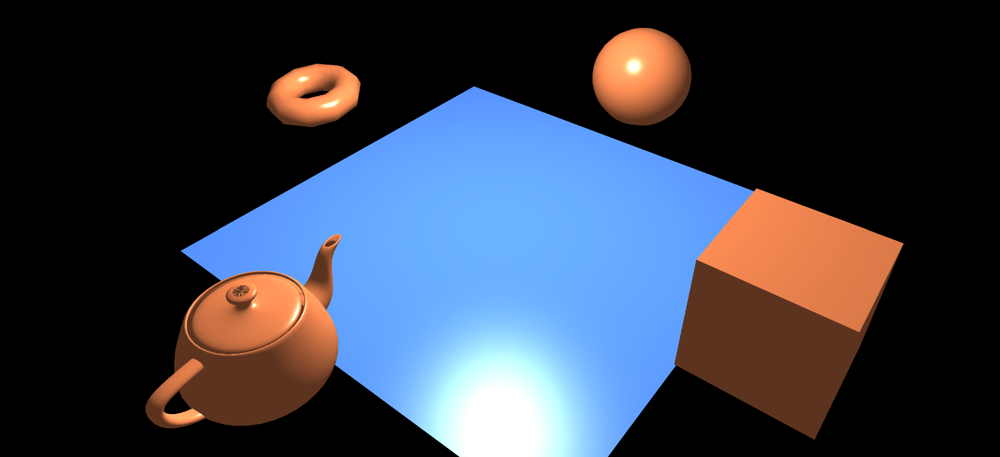

  

I’m a Year 3 Real-Time Interactive Simulation student at the Singapore Institute of Technology. I work in **C++ and C**, with projects in **OpenGL rendering, 3D simulation, and client–server networking**. I’m open to **software development and graphics programming internships in Singapore**.

[**Portfolio ↗**](https://keyeesoo.github.io/) · [**LinkedIn ↗**](https://www.linkedin.com/in/soo-ke-yee)

## Selected projects

### Formula 9 · Autonomous Shuttle Fleet Training Simulator

**Unity · C# · Map-based visualisation**

A simulator that lets operators practise monitoring an autonomous shuttle fleet and responding to simulated traffic incidents. I work on the Unity city view that turns map data into visible roads, lane markings, dividers, and bus stops. I also worked on highlighting affected road segments when a simulated incident appears in the operator interface.

### Custom Game Engine

**C++ · OpenGL · GLSL · CMake**

A custom engine built by a seven-person team to learn how rendering, engine systems, and development tools work together. On the two-person graphics team, I worked on sprite rendering, instancing, and text rendering, and helped integrate graphics with other engine systems. I also used CMake to configure builds and troubleshoot issues while adding libraries and plugins.

<!-- Project preview: add a screenshot at assets/game-engine.png, then insert it here. -->

### OpenGL Shader Effects

**C++ · OpenGL · GLSL · WebGL**

A collection of real-time graphics demos covering lighting, procedural patterns, and multi-pass rendering. I used GLSL to create discrete colour bands for cartoon shading and repeating cutouts driven by surface coordinates. Other demos use fragment shaders to render a miniature solar system and off-screen framebuffers to combine effects like blur and edge detection. The WebGL viewer showcases eight selected demos from the desktop project.

 

<!-- Verify your deployed Pages address, then add the link here:
[Launch the shader viewer in your browser](https://keyeesoo.github.io/graphics-viewer/index.html)
-->

### The Gingerbread Curse

**C · Cyclone DDS · Client–server networking**

A two-player cooking game where players trace dotted shapes against a timer to collect ingredients and complete randomly selected recipes. I implemented the tracing, timers, ingredient handling, and recipe progression in C, and contributed to rendering and performance improvements. I also tested client–server connectivity across two laptops over Wi-Fi with Windows Defender Firewall enabled.

<!-- Project preview: add a screenshot at assets/gingerbread-curse.png, then insert it here. -->
