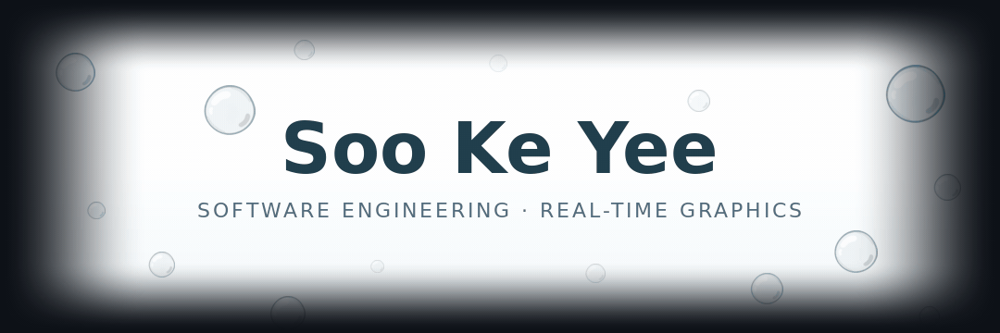
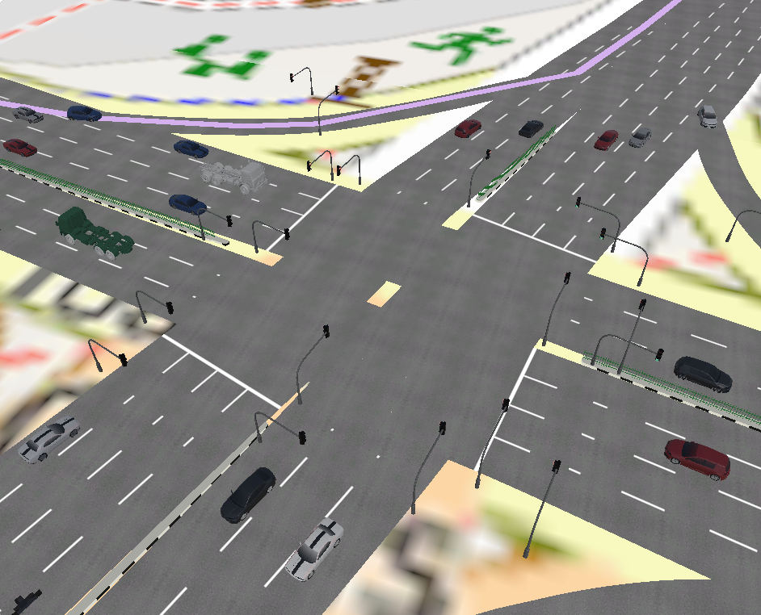

  

I’m a Year 3 Real-Time Interactive Simulation student at the Singapore Institute of Technology. I work in **C++ and C**, with projects in **OpenGL rendering, 3D simulation, and client–server networking**. I’m open to **software development and graphics programming internships in Singapore**.

  
  

## Selected projects

### [Formula 9 · Autonomous Shuttle Fleet Training Simulator](https://github.com/axewhy-xy/Formula9)

  
  
  

A team-built simulator that lets operators practise monitoring an autonomous shuttle fleet and responding to simulated traffic incidents. I work on the Unity city view, using map data to render roads, lane markings, dividers, and bus stops. I also worked on highlighting affected road segments when an incident appears in the operator interface.

### [Seam Carving · Content-Aware Image Resizing](https://github.com/R15hika/seam-carving)

  
  
  
  

This project resizes images by removing connected paths of pixels. I implemented the greedy seam finder, which selects the next pixel one row at a time, and compared it with dynamic programming. In one benchmark, the greedy approach reduced total resize time by **54.5%**. In a separate test on a **200 × 200** image, dynamic programming found a seam with **58.4% lower energy**.

### [The Gingerbread Curse · Networked Potion-Making Game](https://github.com/KeyeeSoo/Low-Level-Programming)

  
  
  

A two-player potion-making game where players trace dotted shapes against a timer to collect ingredients and complete randomly selected recipes. I implemented tracing, timers, ingredient handling, and recipe progression in C, and contributed to rendering and performance improvements. I also debugged and tested client–server connectivity across two laptops over Wi-Fi with Windows Defender Firewall enabled.

### [Game AI · Pathfinding in Randomly Generated Environments](https://github.com/woonning-ng/3183-final)

  
  
  

A team project exploring how game characters navigate randomly generated environments. I implemented the pathfinding logic that lets characters find routes through the generated layouts.
